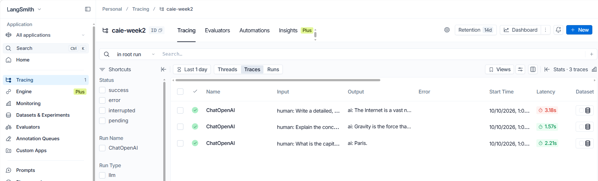
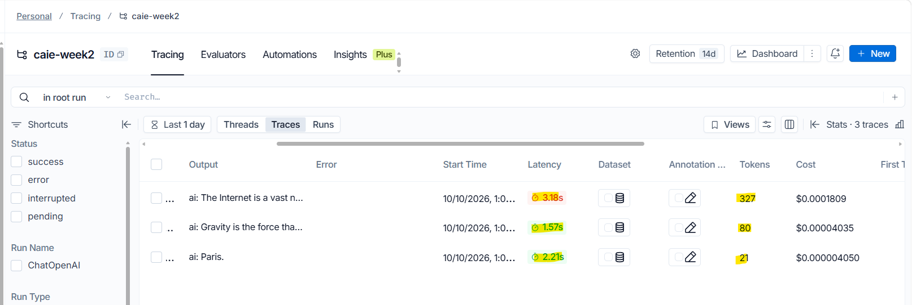
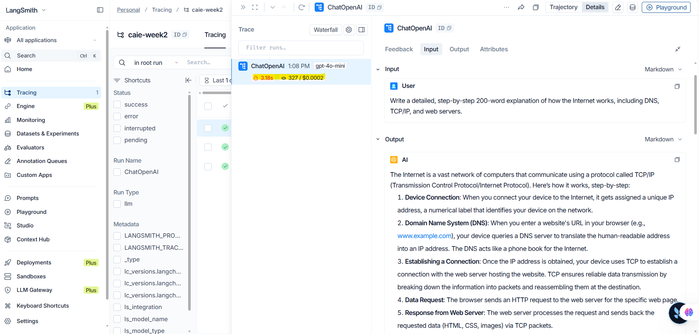

# LangChain + LangSmith Tracing Demo

> See exactly what your LLM calls cost and how long they take, with LangSmith tracing.

    

## Overview

A minimal **LLM observability** example. The script sends three prompts of different complexity (short, medium, long) to `gpt-4o-mini` through LangChain with LangSmith tracing turned on, so you can compare token usage and latency per run in the LangSmith dashboard.

## Features

- Pre-flight check that tracing variables are set
- Three prompts of increasing size
- Runs grouped in one LangSmith project for comparison

## Demo





## Tech stack

| Layer | Technology |
|---|---|
| Orchestration | LangChain |
| Observability | LangSmith |
| Model | OpenAI `gpt-4o-mini` |

## Project structure

```text
.
├── traced_app.py
├── requirements.txt
└── .env.example
```

## Getting started

**Prerequisites:** Python 3.10+, a [LangSmith](https://smith.langchain.com) account

```bash
git clone https://github.com/prasanth-sundararajan/traced-app.git
cd traced-app
python -m venv .venv
# Windows: .venv\Scripts\activate    macOS/Linux: source .venv/bin/activate
pip install -r requirements.txt
```

Copy `.env.example` to `.env` and add your keys:

```bash
cp .env.example .env
```

## Usage

```bash
python traced_app.py
```
Then open your LangSmith project to inspect the three runs.

## Configuration

| Variable | Required | Description |
|---|---|---|
| `OPENAI_API_KEY` | Yes | OpenAI API key used for chat and embeddings |
| `LANGSMITH_TRACING` | Yes | Set to `true` |
| `LANGSMITH_API_KEY` | Yes | LangSmith API key |
| `LANGSMITH_PROJECT` | No | Project name for the runs |

## License

Released under the [MIT License](LICENSE).

## Author

**Prasanth Sundararajan**, Senior SRE and AI Engineer  
[LinkedIn](https://www.linkedin.com/in/prasanth-s-a093a7109/) · [GitHub](https://github.com/prasanth-sundararajan)
